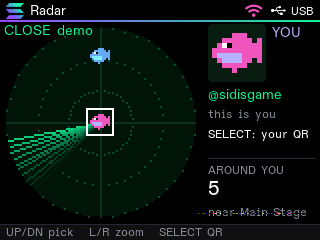

# Radar

**Who's around you at Breakpoint, on your Solana OS badge.** Each person
shows up as a pixel creature on a sweeping radar, labelled with the name
they linked from X.



Pick someone with UP/DOWN and the card on the right shows:

- their X name
- their @handle
- how close they are

SELECT shows a QR that installs Radar. Every copy has that QR, so whoever you
onboard can onboard the next person.

> **AI agents:** read [AGENTS.md](AGENTS.md). It has the full setup and
> deploy procedure, step by step.

## Put it on a badge (new or replacement)

You need:

- the badge, with a microSD card in it
- a USB-C **data** cable (many cables are charge-only)
- a Mac or Linux machine with Python 3

```sh
git clone https://github.com/Sidharth004/solana-badge-radar.git
cd solana-badge-radar
./setup.sh                      # makes .venv, installs pyserial + pillow, runs tests if lua is installed
.venv/bin/python deploy.py      # finds the badge, uploads, starts Radar, saves a screenshot
```

After that, Radar is in the badge's app list.

To test it alone, run `.venv/bin/python deploy.py --demo`. This adds six
simulated people who drift closer and farther, one of them walking in and
out of range.

If Radar is published in the badge App Store, the other way to install it
is to scan someone's invite QR and install it from the store.

## How it detects people

The OS keeps a list of badges heard over ESP-NOW (`mesh.nearby()`), and Radar
reads it once a second.

- **The other person doesn't need the app.** Their badge only has to be on
  the mesh. That happens when they have a mesh app open, or when their Wi-Fi
  is joined on the event's mesh channel (the venue network is meant to be).
  A badge sitting on the home screen off that network sends nothing and
  doesn't show up.
- **Names come from X.** The name in each badge's HELLO is its owner's X
  display name once they link X at `/profile`.
  - The **@handle** comes from the server, for the person you pick, when
    Wi-Fi works from the mesh channel.
  - A badge with no linked X shows its badge id instead.
- Radar sends no messages of its own. Opening it puts your badge on the mesh
  like any mesh app.

## The radius

RSSI is signal strength, not distance: people absorb 2.4 GHz. So Radar uses
**bands**, and smooths the signal because raw readings jump ±10 dB.

| Zoom (L/R) | Shows | Card says |
|---|---|---|
| **CLOSE** | stronger than −60 dBm | `very close` (> −50) · `talking` (> −62) |
| **AREA** (default) | stronger than −75 dBm | `nearby` (> −75) |
| **ALL** | everything heard | `far` · `bridged` |

**Only distance from the centre is real.** Each creature's angle comes from
its badge id, nudged round the ring so creatures never overlap. Nothing on
this hardware can measure direction.

## Keys

| Key | Radar | Invite QR screen |
|---|---|---|
| **UP / DOWN** | pick someone, nearest first (wraps through YOU) | DOWN turns demo people on/off |
| **LEFT / RIGHT** | zoom | |
| **SELECT** | open the invite QR | close it |
| **CANCEL** | exit | close it |

LEDs 1–6 glow in the colours of the six creatures nearest you. On the QR
screen a light chases to catch the other person's eye.

## The creatures

There are 15 original 10×10 species in 8 colourways, plus a rare shiny
(1 in 32).

- **Picked from the badge id**, so a person is the same creature on every
  badge.
- **Original art, not Pokémon.** Copying real Pokémon sprites into a public
  store app invites a takedown.
- **Swappable.** The art is in `SPECIES` and `TYPES` near the top of
  `main.lua`:
  - In the templates, `X` is the body, `Y` the belly, `E` an eye white and
    `k` black.
  - The result must use only the badge's built-in pixel characters
    (`k w p g m v b a l y o`).
  - The tests check both.

## Publish to the badge App Store

1. Link X at `/profile` on the badge site (publishing requires it).
2. Check that the id `badge-radar` is free. If it isn't, change it in
   `app.json` **and** `APP_ID` at the top of `main.lua`. The invite QR is
   built from it.
3. On `/apps/submit`, upload **only `main.lua` and `app.json`**, then
   **Try in emulator**.
4. Publish. Scan your own invite QR once to confirm it opens the app's page.

## Files

| File | What it is |
|---|---|
| `main.lua` | the app (the only code that runs on the badge) |
| `app.json` | store manifest: id, name, version, permissions |
| `test.lua` | 73 checks against a mocked badge API (`lua test.lua`) |
| `deploy.py` | upload, run, drive and screenshot over USB serial |
| `setup.sh` | one-time host setup |
| `AGENTS.md` | instructions for AI coding agents |
| `screenshots/` | real screenshots from a badge |

## Budgets (measured in the mock with 400 badges)

| | Used | Limit |
|---|---|---|
| VM instructions per poll | ~51k | 200k |
| VM instructions per radar frame | ~29k | 200k |
| UI objects | 14 | 128 |
| Timers | 1 | 8 |

## Gotchas learned on real hardware

- **The badge's Lua has 32-bit integers.** Desktop Lua has 64-bit ones, so a
  literal ≥ 2^31 passes desktop tests and crashes on the badge. A test now
  catches this.
- **Opening the serial port on macOS reboots the badge.** Do everything in
  one `deploy.py` run (`--then ...`).
- **Uploads stall if bytes come too fast.** `deploy.py` sends 256-byte pieces
  with short pauses and retries up to 3 times.

## License

MIT
